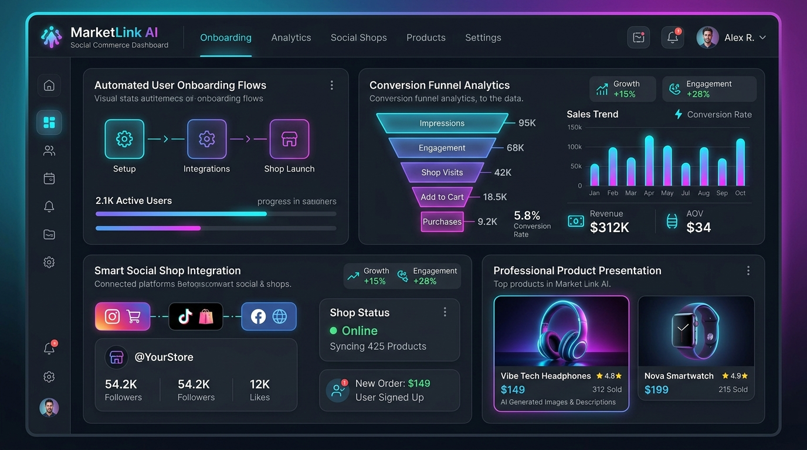
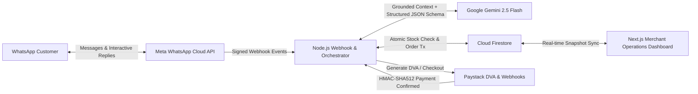

# MarketLink AI — Architecture & Engineering Showcase

> **Autonomous WhatsApp Conversational Commerce Engine** powered by **Google Gemini (2.5 Flash)**, **Meta WhatsApp Cloud API**, **Cloud Firestore atomic transactions**, and **Paystack Dedicated Virtual Accounts (DVA)** auto-verification.

*(Note: This public repository documents the system architecture, concurrency guarantees, and integration workflows of MarketLink AI while keeping proprietary production source code private.)*

---

## Problem Solved

Merchants selling over WhatsApp lose sales to slow manual replies, oversell limited stock during concurrent chats, and waste time manually confirming bank transfers from screenshots.

**MarketLink AI** turns WhatsApp into an automated storefront and checkout channel backed by real-time inventory truth and cryptographic payment confirmation.

---

## High-Level System Architecture

---

## Key Engineering Highlights

### 1. Zero-Hallucination Inventory Grounding
- **Problem:** Standard LLMs invent prices, variants, or out-of-stock availability.
- **Solution:** Every Gemini inference pass is injected with live Firestore catalog documents and constrained via **structured JSON output schemas** (`intent`, `matchedSkuIds`, `quantities`, `responseCopy`). Final totals and stock availability are always computed deterministically in Node.js—never trusted from free-form LLM math.

### 2. Concurrency-Safe Checkout with Atomic Firestore Transactions
- **Problem:** Two shoppers ordering the last unit simultaneously over WhatsApp can cause overselling.
- **Solution:** Order reservation executes inside `db.runTransaction(...)`, reading current available stock, decrementing atomically (`reservedQty`), and committing order state only if `available >= requestedQty`.

### 3. Automated Paystack DVA Bank Transfer Verification
- **Problem:** Nigerian commerce relies heavily on bank transfers, which traditionally require manual receipt verification.
- **Solution:** Each order provisions or maps a **Paystack Dedicated Virtual Account (DVA)**. When a transfer settles, Paystack emits a webhook verified via **HMAC-SHA512** (`x-paystack-signature`), automatically transitioning the order from `PENDING_PAYMENT` → `PAID`, notifying the merchant dashboard, and sending the WhatsApp confirmation receipt.

### 4. Real-Time Merchant Operations Dashboard
- Built with **Next.js** and **TypeScript**, giving merchants live visibility into active WhatsApp sessions, reserved inventory, settled Paystack transactions, and manual override/hand-off controls.

---

## Core Tech Stack

- **AI & Orchestration:** Google Gemini 2.5 Flash, Structured JSON Output Schemas, Prompt Grounding
- **Backend & Webhooks:** Node.js, Express / Cloud Functions, Meta WhatsApp Cloud API
- **Database:** Cloud Firestore (Atomic Transactions & Real-Time Listeners)
- **Payments:** Paystack Dedicated Virtual Accounts (DVA) & HMAC-SHA512 Webhook Verification
- **Frontend Dashboard:** Next.js, React, TypeScript, Tailwind CSS

---

## Author

**Olanipekun Mos'ab Tolohunju** — Full Stack Engineer & Applied AI Builder  
- GitHub: [@Genthub46](https://github.com/Genthub46)  
- Email: [mukhtam083@gmail.com](mailto:mukhtam083@gmail.com)
